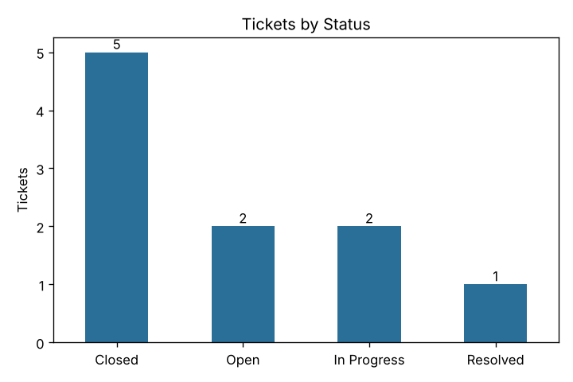

# SupportDesk – Customer Support Ticket and SLA Analytics

M.Sc. Data Science | DBMS for Analytics project (HCL GUVI)
**Student:** Joshua | 26MSDSR020 | **Domain:** Customer Service

A simple database to record support requests, track response times and monitor SLA performance.

## What it does

- **MySQL** stores customers, agents, tickets and SLA targets (4 related tables).
- **SQL queries** answer: tickets by status/priority, workload per agent, open high-priority tickets, and SLA met/breached.
- **Python + pandas** runs the queries, prints reports and saves charts.
- **MongoDB** stores optional ticket comments with flexible fields and tags.

## Schema

```
CUSTOMERS (customer_id PK, customer_name, email)
AGENTS    (agent_id PK, agent_name, team)
SLA       (sla_id PK, priority, response_hours, resolution_hours)
TICKETS   (ticket_id PK, customer_id FK, agent_id FK, issue, priority FK,
           status, created_at, responded_at, resolved_at)
```

One customer → many tickets. One agent → many tickets. Each ticket gets its SLA from its priority.

## Project structure

```
SupportDesk/
├── main.py              # setup / demo / report commands
├── sql/
│   ├── schema.sql       # creates database and tables
│   ├── sample_data.sql  # sample customers, agents, SLA, tickets
│   └── queries.sql      # analytical queries (run in MySQL directly)
├── src/
│   ├── db.py            # MySQL connection + query -> DataFrame
│   ├── tickets.py       # add a new ticket
│   ├── report.py        # pandas report + charts + SLA summary
│   └── comments.py      # MongoDB comments
├── output/              # generated charts and sla_report.csv
├── requirements.txt
└── .env.example
```

## How to run

1. Install MySQL and MongoDB, and make sure both are running.
2. Install Python packages:
   ```bash
   pip install -r requirements.txt
   ```
3. Copy `.env.example` to `.env` and fill in your MySQL password.
4. Create the database and load sample data:
   ```bash
   python main.py setup
   ```
5. Run the full demo (follows the presentation's live demo plan):
   ```bash
   python main.py demo
   ```
   Or only the report: `python main.py report`

Add a ticket from the command line:
```bash
python src/tickets.py --customer 1 --agent 2 --issue "Login error" --priority High
```

You can also run the SQL directly: `mysql -u root -p < sql/schema.sql`, then `sample_data.sql`, then `queries.sql`.

No MongoDB installed? Set `MONGO_MOCK=1` in `.env` to use an in-memory stand-in for the demo.

## Demo flow

1. Show the tables and their relationships
2. Insert a sample support ticket
3. Run the ticket status summary query
4. Show the Python report and charts
5. Display one ticket comment from MongoDB

## Sample results (right after `python main.py setup`)

| Check | Result |
|---|---|
| Response SLA | 6 of 8 answered tickets met target (75%) |
| Resolution SLA | 4 of 6 resolved tickets met target (67%) |
| Open high-priority tickets | Ticket 8 – "Data export failing" |
| Busiest agents | Divya and Priya (3 tickets each) |

Charts are saved in `output/`:



## Conclusion

SupportDesk provides a simple way to organise customer support tickets and monitor SLA performance.
